# Laboratorio 5: rellenar triángulos

Rasterizador por software en Rust (ventana con [raylib](https://crates.io/crates/raylib)) que dibuja triángulos en tres modos:

| Modo | Qué hace |
|---|---|
| `Wireframe` | La implementación original: tres llamadas a `line` (Bresenham). |
| `FilledBarycentric` | Algoritmo 1: recorre el rectángulo envolvente y prueba cada centro de píxel con coordenadas baricéntricas. |
| `FilledScanline` | Algoritmo 2: avanza una fila a la vez y llena el tramo entre las dos aristas que cruza. |

Los dos rellenos generan **exactamente las mismas posiciones** en todos los casos de prueba. Lo compruebo comparando las listas de fragmentos, no solo la imagen. En las mediciones, **el scanline es entre 1.3× y 3.5× más rápido**. El perfil muestra que el baricéntrico gasta casi todo su tiempo en geometría y el scanline en crear fragmentos y hacer crecer el `Vec`.

---

## Cómo ejecutarlo

```bash
cargo run --release                                   # ventana interactiva
cargo run --release -- --benchmark-triangles          # mediciones (sin abrir la ventana)
cargo run --release -- --benchmark-triangles --breakdown   # desglose del tiempo por etapa
cargo run --release -- --compare                      # compara posiciones baricéntrico vs. scanline
cargo run --release -- --export-images docs/img       # un PNG por caso y por modo (sin ventana)
cargo run --release -- --screenshots docs/capturas    # capturas de la ventana con el HUD
cargo test --release                                  # pruebas automáticas
```

**Controles de la ventana:** `1` Wireframe · `2` FilledBarycentric · `3` FilledScanline · `←`/`→` cambiar de caso · `ESC` salir.
El HUD muestra el caso, el modo, cuántos fragmentos se generaron, cuánto tardó `rasterize` y si los dos rellenos coinciden.

## Estructura

```
src/
├── main.rs         ventana (raylib), argumentos, exportación de imágenes y capturas
├── lib.rs
├── triangle.rs     TriangleMode, contorno, Algoritmo 1 (baricéntrico), Algoritmo 2 (scanline)
├── line.rs         Bresenham (lo usa el modo Wireframe)
├── pipeline.rs     primitive_assembly → rasterize → fragment_processing
├── framebuffer.rs  buffer de color en CPU (800×600)
├── fragment.rs     Fragment { x, y, color }
├── vertex.rs       Vertex { position, color }
├── color.rs
├── scenes.rs       casos de prueba y malla aleatoria reproducible
├── compare.rs      compara las posiciones generadas por dos rasterizaciones
└── benchmark.rs    mediciones con Instant + black_box, mediana, desglose por etapa
tests/raster.rs     pruebas de equivalencia y casos límite
docs/               imágenes, capturas, flamegraph y salidas del benchmark
```

### Los modos de dibujo

El pipeline tiene tres etapas, y solo la rasterización depende del modo:

```rust
let triangles = primitive_assembly(&vertices);           // agrupa vértices de 3 en 3
let fragments = rasterize(&triangles, mode);              // ← aquí se elige el algoritmo
fragment_processing(&mut framebuffer, &fragments);        // escribe los fragmentos
```

```rust
#[derive(Clone, Copy)]
pub enum TriangleMode { Wireframe, FilledBarycentric, FilledScanline }

pub fn triangle(v1: &Vertex, v2: &Vertex, v3: &Vertex, mode: TriangleMode) -> Vec<Fragment> {
    match mode {
        TriangleMode::Wireframe => triangle_wireframe(v1, v2, v3),          // 3 × line()
        TriangleMode::FilledBarycentric => triangle_barycentric(v1, v2, v3),
        TriangleMode::FilledScanline => triangle_scanline(v1, v2, v3),
    }
}
```

Cada relleno está en su propia función, que recibe los tres vértices y devuelve un `Vec<Fragment>`. Para cambiar de algoritmo no hay que tocar el ensamblaje de primitivas ni el procesamiento de fragmentos.

---

## Regla común: qué píxeles están dentro

Para que los dos algoritmos produzcan la misma figura, los dos usan exactamente la misma regla (`src/triangle.rs`):

1. **Se evalúa el centro de cada píxel**, `(x + 0.5, y + 0.5)`.
2. **Las posiciones se pasan a punto fijo** con 8 bits de subpíxel (1/256 px), como hacen las GPU. Así todas las comparaciones son con enteros exactos.
   *Por qué:* con `f32`, el baricéntrico decide con productos (`(b.x-a.x)*(p.y-a.y) - …`) y el scanline con una división (`x = a.x + (y-a.y)*dx/dy`). Cuando un centro cae casi sobre una arista, los dos redondeos pueden dar respuestas distintas y aparecen píxeles sueltos de diferencia en los bordes. Con enteros, las dos expresiones son la misma desigualdad y no hay diferencias.
3. **Regla top-left para los empates.** Si un centro cae *exactamente* sobre una arista, el píxel cuenta solo si esa arista es **superior** (horizontal, con el interior debajo) o **izquierda**. En una fila, eso es el intervalo `[x_izq, x_der)`, y en vertical `[y_sup, y_inf)`. Con esta regla, dos triángulos que comparten una arista no dejan huecos ni duplican fragmentos (caso 6).
4. **Área cero = degenerado.** Si los tres vértices son colineales o están repetidos, los rellenos no generan fragmentos y nunca se divide entre el área.
5. **Recorte:** solo se generan posiciones dentro del framebuffer de 800×600. El baricéntrico recorta su rectángulo envolvente y el scanline recorta sus filas y sus tramos.

Todos los fragmentos de relleno usan el mismo color uniforme (`v1.color`). Más adelante, las coordenadas baricéntricas se podrán usar para interpolar atributos.

## Algoritmo 1: coordenadas baricéntricas

```rust
let area = edge_function(a, b, c);
if area == 0 { return; }                  // degenerado: no dividir entre cero
if area < 0 { swap(&mut b, &mut c); }     // orden inverso → mismo triángulo con área positiva

let (min_x, min_y, max_x, max_y) = bounding_box(a, b, c);   // recortado al framebuffer
for y in min_y..=max_y {
    for x in min_x..=max_x {
        let p = centro del píxel (x + 0.5, y + 0.5);
        let w0 = edge_function(b, c, p);   // λ0 = w0 / área
        let w1 = edge_function(c, a, p);   // λ1 = w1 / área
        let w2 = edge_function(a, b, p);   // λ2 = w2 / área
        if w0 + bias0 >= 0 && w1 + bias1 >= 0 && w2 + bias2 >= 0 { emit(x, y); }
    }
}
```

* `edge_function(a, b, p)` es el doble del área con signo del triángulo `(a, b, p)`. Las tres coordenadas baricéntricas son `λi = wi / área` y suman 1.
* **Orden de los vértices:** si el área sale negativa (orden inverso), se intercambian dos vértices. El triángulo no desaparece y genera exactamente los mismos fragmentos en cualquiera de los 6 órdenes posibles (hay una prueba para esto).
* Como después de normalizar el área es positiva, el signo de `λi` es el signo de `wi`. Para saber si el punto está dentro no hace falta dividir.
* `bias = 0` en aristas top-left y `-1` en las demás. Con enteros, `w - 1 >= 0` equivale a `w > 0`, así que los empates solo cuentan en aristas top-left.

## Algoritmo 2: líneas horizontales (scanline)

```rust
ordenar vértices por y → top, mid, bottom
for y in filas cuyo centro está en [top.y, bottom.y) {           // recortadas a 0..600
    let yc = y + 0.5;
    let (a, b) = if yc < mid.y { (top, mid) } else { (mid, bottom) };
    let x_long  = primer centro ≥ intersección de top→bottom con yc;
    let x_short = primer centro ≥ intersección de a→b      con yc;
    for x in min(x_long, x_short)..max(x_long, x_short) { emit(x, y); }   // [x_izq, x_der)
}
```

**Aristas horizontales y vértices sobre una fila.** Cada arista solo está activa en el intervalo semiabierto `[y_superior, y_inferior)`:

* Una arista horizontal tiene un intervalo vacío. Nunca se interseca con la fila, así que nunca se divide entre `dy = 0`.
* Si una fila pasa justo por el vértice del medio, ese vértice pertenece a la arista que empieza ahí y no a la que termina. Por eso en cada fila hay exactamente dos aristas activas y la fila no se procesa dos veces ni se salta.
* Una arista horizontal superior se incluye (su fila es `top.y`, que entra en `[top.y, …)`) y una inferior no. Es la misma regla top-left del baricéntrico.

La intersección `x = a.x + (yc - a.y)·(b.x - a.x)/(b.y - a.y)` se calcula como una fracción exacta `num/den` y se redondea con división entera (`ceil_div`), sin pasar por números flotantes.

---

## Imágenes de cada modo

Capturas de la ventana (`--screenshots`). Las imágenes sin HUD, píxel a píxel, están en [`docs/img/`](docs/img).

| Caso | Wireframe | FilledBarycentric | FilledScanline |
|---|---|---|---|
| 1. Pequeño (~40 px) y grande (~133 000 px) | 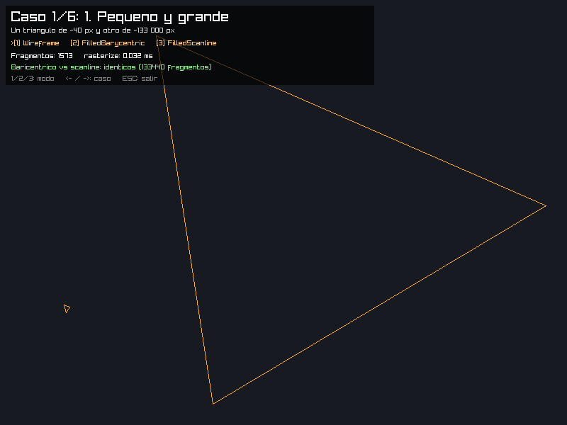 |  | 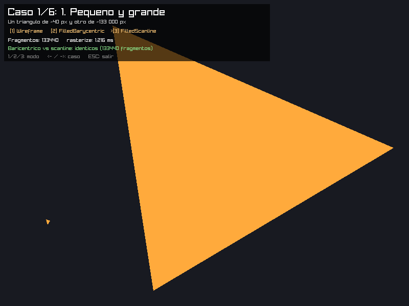 |
| 2. Borde horizontal (y = 160.5) y vertical (x = 460.5), sobre centros de píxel | 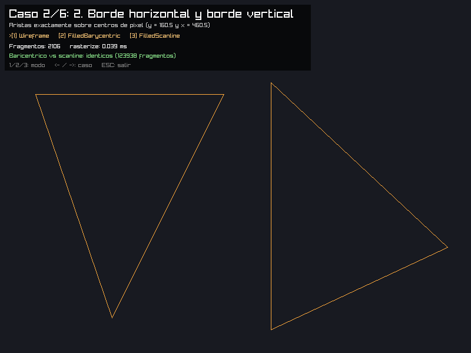 | 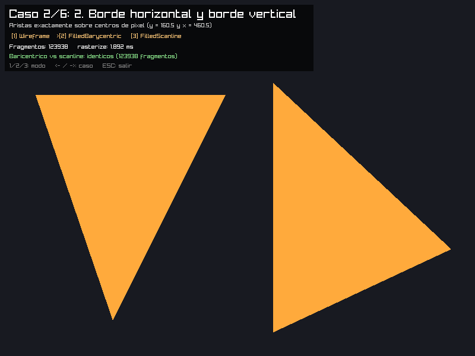 |  |
| 3. Mismos vértices en orden inverso | 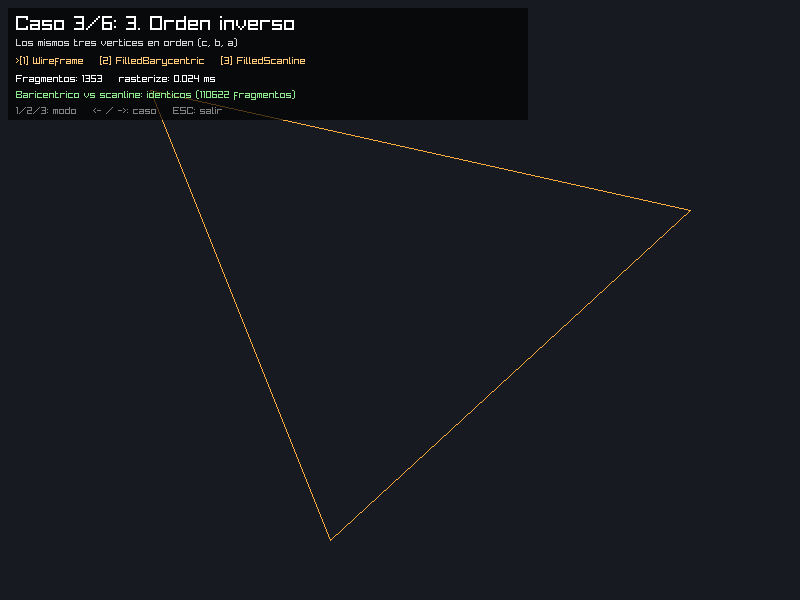 |  | 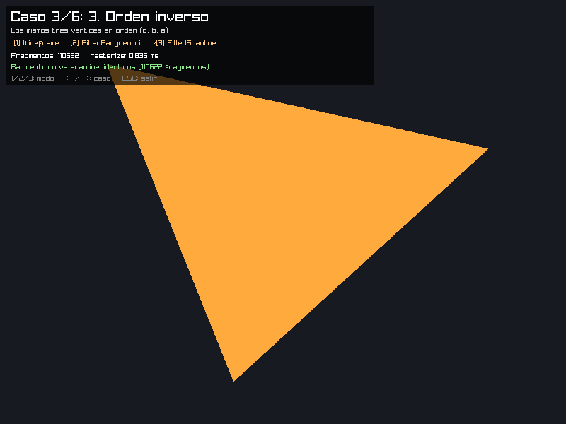 |
| 4. Parcialmente fuera del framebuffer | 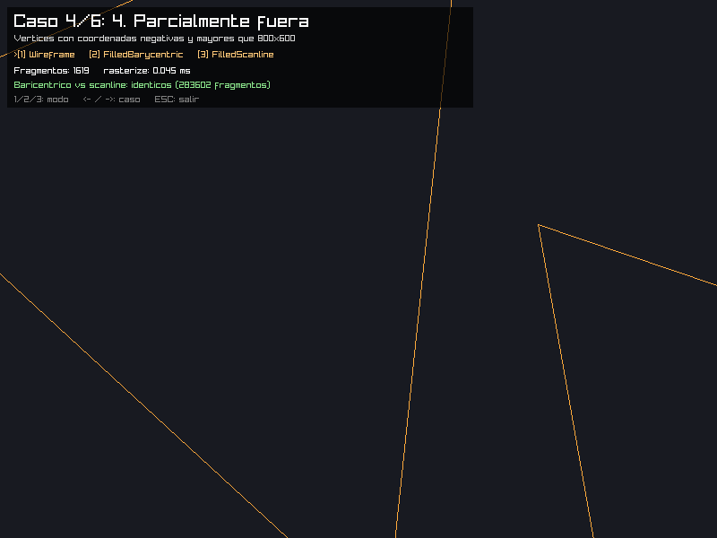 |  | 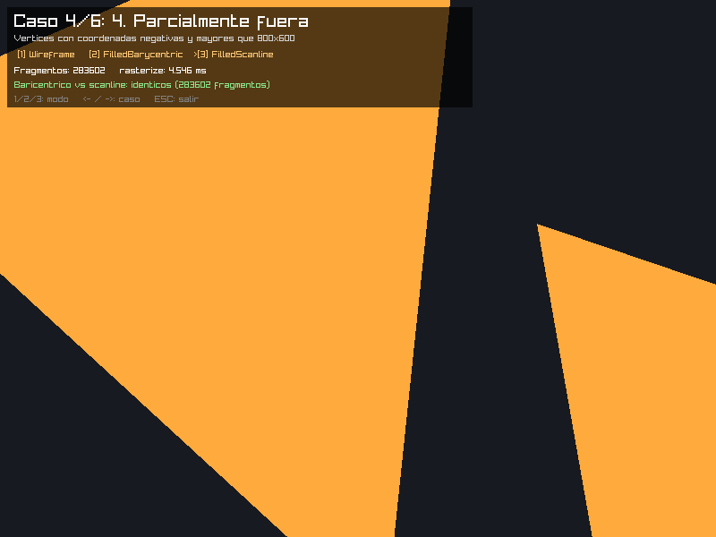 |
| 5. Tres vértices sobre una misma línea (y uno repetido) | 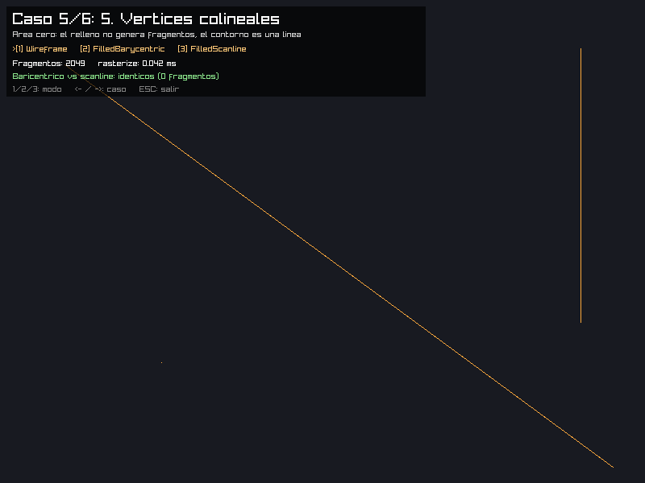 | 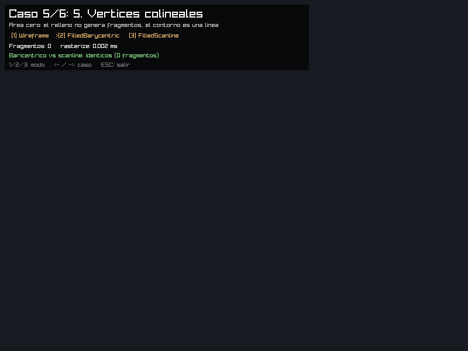 |  |
| 6. *Extra:* abanico de 12 triángulos con aristas compartidas | 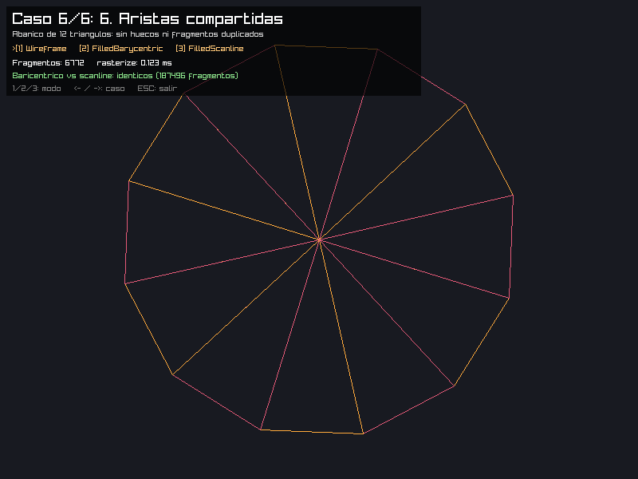 |  | 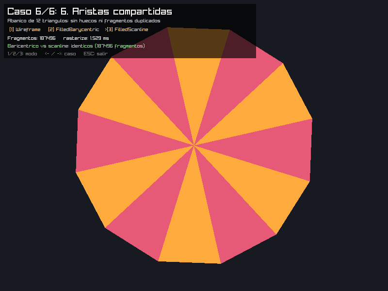 |

En el caso 5, los rellenos quedan vacíos a propósito porque el área es cero. El contorno sí se dibuja: dos líneas y un punto.

## Comprobación de resultados

Los dos algoritmos usan el mismo color y la misma regla de centros de píxel. Comparo las **posiciones** generadas: ordeno las listas de fragmentos y busco posiciones que estén solo en una de ellas y posiciones repetidas (`--compare`, salida en [`docs/comparacion.txt`](docs/comparacion.txt)):

| Caso | Baricéntrico | Scanline | Solo baricéntrico | Solo scanline | Duplicados | Resultado |
|---|---:|---:|---:|---:|---:|---|
| 1. Pequeño y grande | 133 440 | 133 440 | 0 | 0 | 0 / 0 | idénticos |
| 2. Borde horizontal y vertical | 123 938 | 123 938 | 0 | 0 | 0 / 0 | idénticos |
| 3. Orden inverso | 110 622 | 110 622 | 0 | 0 | 0 / 0 | idénticos |
| 4. Parcialmente fuera | 283 602 | 283 602 | 0 | 0 | 0 / 0 | idénticos |
| 5. Vértices colineales | 0 | 0 | 0 | 0 | 0 / 0 | idénticos |
| 6. Aristas compartidas | 187 496 | 187 496 | 0 | 0 | 0 / 0 | idénticos |

Además, el triángulo del caso 3 en orden original `(a, b, c)` y en orden inverso `(c, b, a)` produce los mismos 110 622 fragmentos con ambos algoritmos. Los PNG exportados de ambos rellenos son idénticos byte a byte.

Las pruebas automáticas (`cargo test --release`, en `tests/raster.rs`) comprueban:

* que ambos algoritmos generan las mismas posiciones en los 6 casos, en **3000 triángulos aleatorios** y en **2000 triángulos con vértices en múltiplos de ½ px** (muchos centros caen exactamente sobre aristas y hay muchas aristas horizontales y verticales);
* que el conteo coincide con una **referencia independiente** que prueba los 480 000 centros de la pantalla en `f64`;
* la regla top-left: se incluyen la arista superior y la izquierda, y se excluyen la inferior y la derecha;
* que los 6 órdenes de los vértices dan el mismo resultado;
* el recorte: ningún fragmento fuera de 800×600 y un triángulo completamente fuera no genera nada;
* que un triángulo degenerado no genera relleno pero sí contorno;
* aristas compartidas: un rectángulo de 40×40 dividido en dos triángulos da **exactamente 1600** fragmentos, sin duplicados;
* que un triángulo diminuto que no contiene ningún centro de píxel genera 0 fragmentos en ambos.

### ¿Hubo diferencias en los bordes?

Con la regla de arriba, no. Antes de fijarla, las diferencias posibles eran exactamente las que menciona el enunciado:

* **Centros sobre una arista:** si un algoritmo usa `>= 0` y el otro `> 0`, o si el scanline incluye ambos extremos del tramo, aparecen columnas o filas duplicadas en una arista. Las dos implementaciones usan top-left: el baricéntrico con el `bias` de cada arista y el scanline con los intervalos semiabiertos `[x_izq, x_der)` y `[y_sup, y_inf)`.
* **Redondeo:** con flotantes, el baricéntrico (multiplicaciones) y el scanline (división) pueden discrepar en centros que caen a ~1e-6 px de una arista. Por eso convierto a punto fijo y comparo enteros.

---

## Mediciones

* Se compila con `cargo run --release -- --benchmark-triangles`.
* **Solo se mide `rasterize`**: la generación y el almacenamiento de fragmentos. Quedan fuera el procesamiento de fragmentos, la actualización de la textura, el dibujo y las esperas entre cuadros (no se abre la ventana).
* Cada medición son **100 ejecuciones** de `rasterize` sobre los mismos triángulos, envueltas en `std::hint::black_box`. Se hacen **11 mediciones** y se reporta la **mediana**, con una ejecución previa de calentamiento.
* Equipo: Intel Core i5-1135G7 (11.ª gen., portátil), Linux 6.18 LTS, rustc 1.97.0, un hilo.

Salida completa en [`docs/benchmark.txt`](docs/benchmark.txt). Tiempo por ejecución de `rasterize` (mediana / 100):

| Caso | Fragmentos (ambos rellenos) | Píxeles probados por el baricéntrico | Wireframe | Baricéntrico | Scanline | Scanline más rápido |
|---|---:|---:|---:|---:|---:|---:|
| 1. Pequeño y grande | 133 440 | 287 179 (2.15×) | 12.7 µs | 1825 µs | 903 µs | **2.02×** |
| 2. Borde horizontal y vertical | 123 938 | 249 022 (2.01×) | 18.7 µs | 1578 µs | 768 µs | **2.06×** |
| 3. Orden inverso | 110 622 | 243 991 (2.21×) | 10.3 µs | 1583 µs | 752 µs | **2.10×** |
| 4. Parcialmente fuera | 283 602 | 382 600 (1.35×) | 24.1 µs | 6274 µs | 4827 µs | **1.30×** |
| 5. Colineales | 0 | 0 | 18.7 µs | 0.2 µs | 0.2 µs | — |
| 6. Aristas compartidas (12 triángulos) | 187 496 | 470 640 (2.51×) | 66.6 µs | 3102 µs | 1158 µs | **2.68×** |
| 7. Malla aleatoria (1000 triángulos) | 1 178 594 | 3 970 736 (3.37×) | 2675 µs | 27 121 µs | 7781 µs | **3.49×** |

Wireframe genera 1 573 / 2 106 / 1 353 / 1 619 / 2 049 / 6 772 / 136 792 fragmentos en los casos 1 a 7.

**Ambos rellenos generan siempre la misma cantidad de fragmentos.** Así que la diferencia de tiempo no viene de que uno omita parte del triángulo, sino del trabajo que hace cada uno para encontrarlos:

* El baricéntrico prueba **cada píxel del rectángulo envolvente**. Un triángulo ocupa como mucho la mitad de su rectángulo, y menos si es delgado o está inclinado. La columna "píxeles probados" lo muestra: hace entre 1.35× y 3.37× más pruebas que fragmentos útiles. **La ventaja del scanline sigue casi exactamente esa proporción** (2.15→2.02, 2.21→2.10, 1.35→1.30, 3.37→3.49).
* El scanline hace dos divisiones por fila y después solo escribe fragmentos. No prueba ningún píxel que esté fuera.
* El caso 4 es el que menos diferencia tiene (1.3×). Los triángulos recortados por la pantalla llenan mejor su rectángulo, y además ahí domina el costo de memoria del `Vec` (ver el desglose más abajo).
* Los vértices colineales cuestan casi nada en ambos: se descartan antes de recorrer píxeles.

---

## Perfilador: ¿dónde se va el tiempo?

### Cómo se generó el perfil

El enunciado sugiere `cargo flamegraph -- --benchmark-triangles`. En Linux, `cargo-flamegraph` necesita `perf`, que en mi equipo no está instalado y requiere permisos de administrador. Por eso añadí al programa un perfilador por muestreo dentro del proceso ([`pprof`](https://crates.io/crates/pprof), como *feature* opcional). Usa `SIGPROF` y genera el mismo tipo de flamegraph:

```bash
cargo run --release --features pprof -- --benchmark-triangles --repeats 5 --pprof-flamegraph docs/flamegraph.svg
```

El modo `--benchmark-triangles` también funciona con el comando del enunciado si `perf` está disponible:

```bash
sudo pacman -S perf && cargo install flamegraph
cargo flamegraph -- --benchmark-triangles
```

El perfil es [`docs/flamegraph.svg`](docs/flamegraph.svg) (ábranlo en el navegador para que sea interactivo: se puede hacer zoom y buscar). En `Cargo.toml` se activan los símbolos de depuración del perfil `release` para que aparezcan los nombres de las funciones.

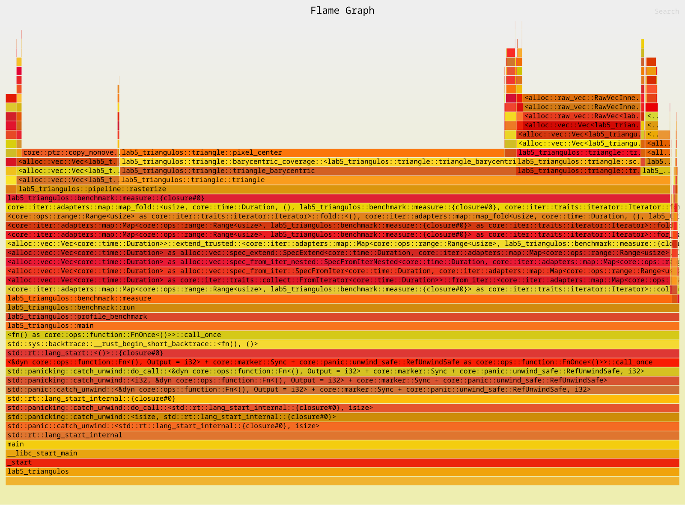

### Lectura del flamegraph

El ancho de cada bloque es la proporción de muestras en las que esa función estaba en la pila, **no** el orden en que se ejecutó. Del total de muestras:

| Bloque | % de las muestras | Qué representa |
|---|---:|---|
| `rasterize` | 97.0 % | todo el benchmark |
| └ `triangle_barycentric` → `barycentric_coverage` | 58.8 % | |
|   └ bucle del rectángulo (aparece como `pixel_center`) | 57.0 % | **cálculos geométricos**: centro del píxel y las tres funciones de arista |
|   └ `Vec::push` | 1.7 % | creación de fragmentos |
| └ `triangle_scanline` → `scanline_coverage` | 18.5 % | |
|   └ `Vec::push` (incluye `grow_one` → `realloc`) | 18.4 % | **creación de fragmentos y crecimiento del `Vec`** |
| └ `Vec::extend` → `append_elements` → `copy_nonoverlapping` | 15.3 % | **copiar** el `Vec` de cada triángulo al resultado final |
| └ `triangle_wireframe` → `line` | 4.4 % | contorno |

* En el **baricéntrico** casi todo el bloque está en el bucle que recorre el rectángulo. Lo más caro es la geometría, no los fragmentos.
* En el **scanline** casi no aparece la geometría (dos divisiones por fila). Prácticamente todo el bloque es `Vec::push`: escribir fragmentos, y `grow_one`/`realloc` cuando el `Vec` se llena.
* Un 15 % adicional es `extend`, que copia los fragmentos del `Vec` de cada triángulo al `Vec` que devuelve `rasterize`. En total, `grow_one` (crecimiento por `push`) suma 4.4 %, `realloc` 4.3 % y `brk` 1.7 % (memoria que se le pide y se le devuelve al sistema operativo).

> Nota: con `--release` las funciones pequeñas (`edge_function`, `Fragment::new`, el closure que hace `push`) se *inlinean*. El perfilador atribuye esas muestras a la línea de código más cercana según la información de depuración, así que el reparto *dentro* de una función inlineada es aproximado. Por ejemplo, las muestras del bucle baricéntrico aparecen bajo `pixel_center`, y en otra ejecución aparecieron bajo `RangeInclusive::next`: es el mismo bucle con otra etiqueta. Lo confiable es el ancho de `triangle_barycentric`, `triangle_scanline`, `push` y `extend`. Para confirmarlo con números hice el desglose siguiente.

### Desglose medido por etapas

Para separar los tres costos, el núcleo de cada algoritmo (`barycentric_coverage` / `scanline_coverage`) emite posiciones a un *closure*, y `triangle_barycentric` / `triangle_scanline` solo las guardan en un `Vec`. `--benchmark-triangles --breakdown` mide cuatro versiones, agregando una parte del trabajo a la vez (salida completa en [`docs/breakdown.txt`](docs/breakdown.txt)):

1. **Solo geometría**: decidir qué píxeles están dentro, contándolos sin guardar nada.
2. **+ escribir fragmentos** en un `Vec` reutilizado que ya tiene capacidad.
3. **+ memoria nueva** en cada ejecución (`Vec::with_capacity` exacto, sin crecimiento).
4. **Implementación completa**: un `Vec` vacío por triángulo que crece con `push`, más el `extend` en `rasterize`.

| Caso | Algoritmo | 1. Geometría | 2. + fragmentos | 3. + memoria nueva | 4. Completa (Vec crece + extend) |
|---|---|---:|---:|---:|---:|
| 1. Grande | Baricéntrico | 1598 µs (84 %) | 1683 µs | 1699 µs | 1907 µs |
| 1. Grande | Scanline | **8.7 µs (1 %)** | 668 µs | 702 µs | 927 µs |
| 4. Parcialmente fuera | Baricéntrico | 2268 µs (31 %) | 2853 µs | 2912 µs | **7342 µs** |
| 4. Parcialmente fuera | Scanline | 15.6 µs (0.3 %) | 1508 µs | 1549 µs | **5998 µs** |
| 7. Malla aleatoria | Baricéntrico | 23 450 µs (86 %) | 25 891 µs | 25 619 µs | 27 329 µs |
| 7. Malla aleatoria | Scanline | 929 µs (11 %) | 6666 µs | 6686 µs | 8313 µs |

Conclusiones:

* **Baricéntrico → los cálculos geométricos.** En los casos 1 y 7, el 84–86 % del tiempo es la prueba de los píxeles del rectángulo, aunque solo se guarden los que están dentro. Escribir los fragmentos añade poco (5–10 %): el procesador escribe mientras sigue calculando.
* **Scanline → la creación de fragmentos.** La geometría es casi gratis (8.7 µs para 133 000 fragmentos). En los casos 1 y 7, cerca del 70 % del tiempo es escribir cada `Fragment` (12 bytes) en memoria, unos 5 ns por fragmento.
* **El crecimiento del `Vec` (etapa 3 → 4) cuesta entre el 6 y el 24 %** del total en los casos 1 y 7, y mucho más con triángulos muy grandes. En el caso 4 (un triángulo de ~270 000 píxeles, ~3 MB de fragmentos) añade **+4.4 ms**, el 60–75 % del total. Cada `realloc` copia todo lo que ya había, el `extend` lo vuelve a copiar, los bloques ya no caben en la caché y la memoria se pide y se devuelve al sistema operativo en cada ejecución (`brk` en el perfil). Por eso en ese caso el scanline cuesta 17 ns por fragmento, contra unos 6.5 ns en los demás.
* Mejoras posibles, guiadas por el perfil: reservar la capacidad del `Vec` con el área del triángulo, escribir directamente en un único `Vec` de salida en lugar de crear uno por triángulo y luego copiarlo, reutilizar ese `Vec` entre cuadros y, para el baricéntrico, evaluar las funciones de arista de forma incremental (sumar una constante por píxel) o descartar bloques del rectángulo completos. No las apliqué a las funciones medidas, para que los números de arriba correspondan a las implementaciones tal como se piden en el laboratorio.

## Resumen de diferencias encontradas

* **Figura:** ninguna diferencia. Con la misma regla (centros de píxel, punto fijo y top-left), ambos rellenos generan exactamente las mismas posiciones en todos los casos y en miles de triángulos aleatorios.
* **Rendimiento:** el scanline es 1.3×–3.5× más rápido, y la ventaja crece con la proporción de píxeles desperdiciados del rectángulo envolvente (triángulos delgados o inclinados, mallas con muchos triángulos).
* **Dónde se va el tiempo:** en el baricéntrico, en la geometría (probar el rectángulo). En el scanline, en escribir fragmentos. En ambos, el crecimiento y la copia de los `Vec` es un costo importante que domina cuando los triángulos son muy grandes.
